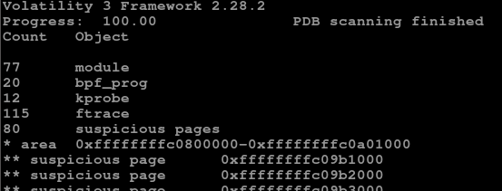

# execmem_scan

**execmem_scan** is a Linux kernel rootkit detection and memory analysis tool that leverages the kernel's executable memory management subsystem, `execmem`, to identify potentially malicious or anomalous kernel memory regions.

Traditional rootkit detection approaches often rely on signatures, known Indicators of Compromise (IOCs), and system-level enumeration. While effective against many known threats, these approaches can be bypassed by rootkits that manipulate enumeration mechanisms, conceal their presence, or operate from memory regions that are not properly accounted for by conventional detection tools.

execmem_scan takes a different approach: instead of relying exclusively on known indicators, it examines the kernel memory regions managed by `execmem`, analyzes their contents and associated memory structures, and identifies regions that cannot be properly classified or accounted for.

The project provides two complementary implementations:

- **Volatility plugin:** Offline analysis of Linux memory dumps.
- **Linux kernel module:** Live analysis of the memory regions of a running Linux system.

The goal is to provide a complementary detection and forensic analysis capability for investigating Linux kernel compromise, particularly rootkits that leverage executable kernel memory for stealth and evasion.

---

## Features

- Enumeration of active memory regions managed by `execmem`.
- Analysis of executable kernel memory at page level.
- Identification and classification of memory associated with kernel modules, kprobes, ftrace, and BPF.
- Detection of memory regions that cannot be attributed to expected kernel subsystems.
- Extraction of suspicious memory regions for further analysis.
- Offline memory analysis through a Volatility plugin.
- Live memory analysis through a Linux kernel module.

---

## Detection Approach

Linux kernel rootkits can leverage different mechanisms to execute malicious code, modify kernel behavior, intercept function calls, and evade conventional security monitoring. Some of these mechanisms rely on executable memory allocated and managed by kernel subsystems.

execmem_scan focuses on analyzing this memory from a structural perspective. By examining the memory regions managed by `execmem` and correlating them with the kernel structures responsible for their allocation and usage, it aims to identify anomalies that may indicate malicious activity.

Rather than relying exclusively on signatures or previously documented indicators, execmem_scan evaluates whether executable memory regions can be associated with expected kernel components and allocation patterns.

Memory regions that cannot be properly classified are flagged for further investigation and, where applicable, extracted for forensic analysis.

This approach can help identify suspicious kernel code even when its contents or behavior are not previously known.

---

## Architecture

execmem_scan consists of two independent implementations sharing the same detection concept.

| Component | Description |
|---|---|
| **Volatility plugin** | Analyzes Linux memory dumps, allowing offline investigation without interacting with the potentially compromised system. |
| **Linux kernel module** | Performs memory analysis directly on a running Linux system. |

Both implementations examine execmem-managed memory and attempt to identify, classify, and extract suspicious memory regions.

> **Development status:** The Volatility plugin currently implements more functionality than the Linux kernel module. Both implementations are under active development, and their capabilities will gradually be brought into parity.

---

## Understanding execmem

`execmem` is the Linux kernel subsystem responsible for managing executable memory allocations used by different kernel components. Its allocation mechanisms are used by several subsystems, including kernel modules, kprobes, ftrace, and BPF.

These subsystems provide legitimate kernel functionality but can also be abused by rootkits to execute malicious code, alter kernel behavior, or implement stealth and evasion techniques.

### Memory Management Structures

The memory regions managed by execmem are represented by `vmap_area` structures. These regions are grouped into `vmap_node` structures, which are organized in an array referenced by the `vmap_nodes` symbol.

The number of entries in this array, corresponding to the number of `vmap_node` structures, is defined by the `nr_vmap_nodes` symbol.

```
vmap_nodes
    |
    +->+---------------+
       |               |   vmap_nodes
       |   vmap_node   |      [0]
       |               |
       +---------------+
       |               |   vmap_nodes
       |   vmap_node   |      [1]
       |               |
       +---------------+
              ...
       +---------------+
       |               |   vmap_nodes
       |   vmap_node   | [nr_vmap_nodes]
       |               |
       +---------------+
```

Each `vmap_node` maintains active and free memory regions. Active regions can be traversed through the linked list referenced by `vmap_node->busy->head`.

execmem_scan enumerates these structures and selects active `vmap_area` regions, focusing the analysis on memory allocated through execmem. 

### Memory Allocation Types

The memory allocation types handled by execmem are defined in `enum execmem_type`, declared in `execmem.h`:

```c
enum execmem_type {
    EXECMEM_DEFAULT,
    EXECMEM_MODULE_TEXT = EXECMEM_DEFAULT,
    EXECMEM_KPROBES,
    EXECMEM_FTRACE,
    EXECMEM_BPF,
    EXECMEM_MODULE_DATA,
    EXECMEM_TYPE_MAX,
};
```

These allocation types correspond to different kernel subsystems and memory usage patterns. Understanding these distinctions is essential for classifying memory regions and identifying allocations that do not match expected behavior.

### Memory Allocation Patterns

The memory layout depends on the subsystem requesting the allocation:

- **Modules, kprobes, and ftrace:** Executable code is allocated within memory regions consisting of 512 pages. When an allocation cannot be accommodated within an existing region, a new region is allocated.
- **BPF:** BPF programs are allocated within dedicated 512-page regions. Memory within these regions is managed by the BPF JIT memory allocator.
- **Module data:** Module data is allocated separately in regions sized according to the module's requirements. Each module has its own data allocation.

On x86, pages that are free or have been released may be filled with `0xCC` (`INT3`) as a protective measure against unintended execution of stale memory. execmem_scan also takes this memory pattern into account during its analysis.

---

## Detection Workflow

execmem_scan follows a structured analysis process:

1. **Enumeration:** Identify active memory regions managed by execmem.
2. **Page-level analysis:** Iterate through the pages belonging to the selected memory regions.
3. **Classification:** Associate memory pages with their expected subsystem, including modules, kprobes, ftrace, and BPF.
4. **Anomaly identification:** Flag pages or regions that cannot be classified according to the expected structures and allocation patterns.
5. **Extraction:** Dump suspicious memory regions to facilitate further investigation and forensic analysis.

The resulting findings can be used to investigate potentially malicious kernel code, identify anomalies in executable memory, and support subsequent forensic analysis.

---

## Detection Coverage

execmem_scan currently focuses on executable memory associated with the following kernel subsystems:

| Subsystem | Description | Status |
|---|---|---|
| Kernel Modules (LKM) | Executable memory associated with dynamically loaded kernel modules. | Supported |
| Kprobes | Executable memory associated with dynamically instrumented kernel functions. | Supported |
| Ftrace | Executable memory associated with function tracing and instrumentation. | Supported |
| BPF | Memory associated with BPF programs and the BPF JIT allocator. | Under investigation / limited coverage |

### Kernel Modules (LKM)

Loadable Kernel Modules (LKMs) are components that can be dynamically loaded into the Linux kernel to extend its functionality without requiring a kernel rebuild or system reboot. They are commonly used for device drivers and other kernel extensions.

Rootkits can abuse LKMs to execute code with kernel privileges, modify internal kernel structures, alter kernel functionality, intercept system calls, and manipulate enumeration mechanisms to hide processes, files, network connections, or other system entities.

Because kernel modules operate in kernel space, they can also interfere with security tools and undermine conventional detection mechanisms.

execmem_scan analyzes module-related executable memory to identify and investigate memory regions that may not correspond to expected kernel module structures.

### Ftrace

Ftrace is the Linux kernel tracing framework used to trace function execution and monitor kernel activity. Among its capabilities, it supports function tracing and mechanisms that allow tracing infrastructure to redirect or instrument function execution.

Rootkits may abuse ftrace-related functionality to hook kernel functions, modify execution flow, intercept operations, or evade security monitoring.

execmem_scan analyzes memory associated with ftrace and enumerates active ftrace_ops structures from the list referenced by ftrace_ops_list. The ftrace_ops structure defines tracing operations, including callbacks and the functions they are associated with. By examining these structures, execmem_scan can identify potentially hidden ftrace callbacks and determine how many functions are actually being traced, helping detect discrepancies between registered tracing operations and the functions being instrumented.

### Kprobes

Kprobes provide a kernel instrumentation mechanism that allows developers and tracing tools to dynamically attach probes to selected kernel instructions or functions.

Rootkits can abuse kprobes to intercept kernel execution, monitor system activity, manipulate function behavior, or implement stealth mechanisms without necessarily relying on a conventional kernel module enumeration approach.

execmem_scan examines memory associated with kprobes to identify suspicious or unaccounted executable regions.

### BPF

eBPF enables the execution of specialized programs within the kernel through a controlled runtime environment. It is used for observability, networking, security monitoring, and other purposes.

Although execmem is involved in managing executable memory used by BPF, BPF programs rely on dedicated allocation mechanisms through the BPF JIT memory allocator. These memory regions require a separate analysis approach.

Consequently, eBPF-based rootkits are currently outside the scope of execmem_scan's detection capabilities.

---

## Limitations

execmem_scan is designed to identify anomalies in execmem-managed memory. It is not intended to provide comprehensive detection of every Linux rootkit technique.

### eBPF-based rootkits

eBPF-based rootkits are currently outside the scope of the tool. Although BPF-related executable memory is associated with kernel executable memory management, its allocation and management mechanisms require a dedicated analysis approach.

### Function hooking without memory anomalies

Rootkits that rely exclusively on function hooking, without introducing detectable anomalies in the memory regions analyzed by execmem_scan, cannot necessarily be identified through this approach alone.

For example, a rootkit may manipulate the output of `lsmod` to hide a loaded module while leaving the module present in the kernel's internal module list. In this scenario, execmem_scan may still account for the module and fail to identify it as malicious.

However, its findings can be cross-referenced with the output of conventional enumeration tools to identify discrepancies. If execmem_scan accounts for X loaded modules while `lsmod` reports only X-1, this inconsistency may indicate the presence of a hidden module and warrant further investigation.

execmem_scan should therefore be considered a complementary detection and forensic analysis tool rather than a standalone rootkit detection solution.

---

## Screenshots

### Volatility Plugin



### Linux Kernel Module


---

## Repository Structure

```text
execmem_scan/
├── README.md
├── docs/
│   └── images/
│       ├── linux_module.png
│       └── volatility_plugin.png
├── module/
│   ├── Makefile
│   ├── README.md
│   └── execmem_scan.c
└── volatility/
    ├── README.md
    └── execmem_scan.py
```

---

## Disclaimer

execmem_scan is a security research project intended for defensive security research, kernel memory analysis, rootkit detection, and forensic investigation.

The tool is under active development. The Volatility plugin currently provides more functionality than the Linux kernel module, and their capabilities will gradually be brought into parity.

Detection results should be interpreted in context and investigated further. Anomalous memory regions do not necessarily indicate malicious activity, and the absence of findings does not guarantee that a system is free from rootkits.

---

## Contributing and Feedback

Feedback, bug reports, ideas, and contributions are welcome.

If you identify potential detection gaps, false positives, implementation issues, or opportunities to improve the analysis methodology, feel free to open an issue or submit a pull request.

The goal is to improve execmem_scan and explore new approaches to Linux kernel rootkit detection through memory analysis.
