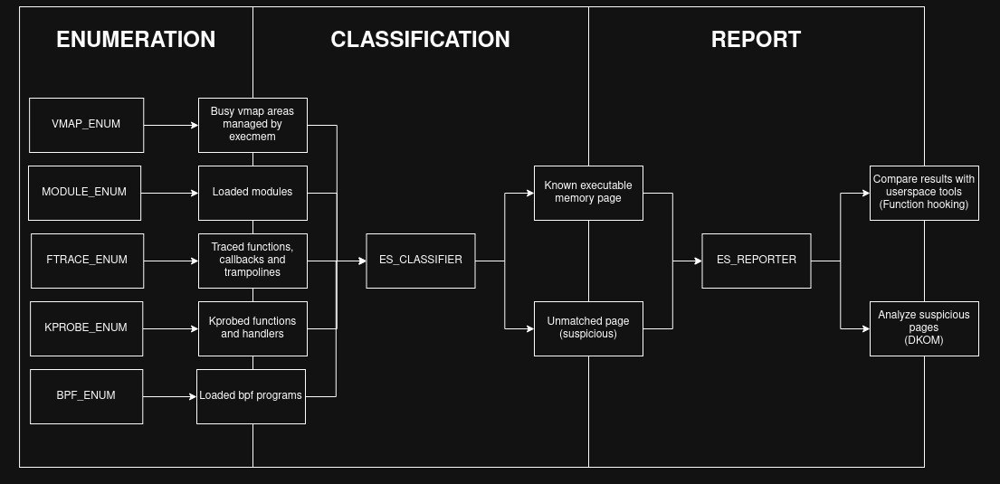
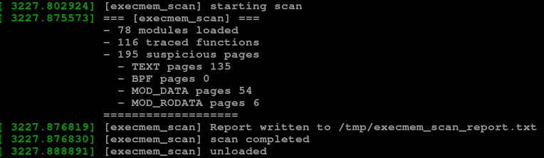

# execmem_scan

**execmem_scan** is a Linux kernel rootkit detection and memory analysis tool that leverages the kernel's executable memory management subsystem, `execmem`, to identify potentially malicious or anomalous kernel memory regions.

Traditional rootkit detection approaches often rely on signatures, known Indicators of Compromise (IOCs), and system-level enumeration. While effective against many known threats, these approaches can be bypassed by rootkits that manipulate enumeration mechanisms, conceal their presence, or operate from memory regions that are not properly accounted for by conventional detection tools.

execmem_scan takes a different approach: instead of relying exclusively on known indicators, it examines the kernel memory regions managed by `execmem`, analyzes their contents and associated memory structures, and identifies regions that cannot be properly classified or accounted for.

Why `execmem`? The Linux execmem infrastructure manages executable memory used by kernel modules, Ftrace, Kprobes, and BPF. These are the mechanisms leveraged by kernel-space rootkits to introduce malicious code into the kernel, hook functions, or modify execution flow. Their executable memory resides within the kernel module memory region, bounded by MODULES_VADDR and MODULES_END. This makes execmem a particularly interesting area for kernel integrity analysis: it is a well-defined memory space where legitimate executable code and kernel instrumentation reside, but where kernel-space rootkits leveraging these mechanisms must also operate. Their presence will therefore introduce anomalies in this region, making it a valuable target for enumeration, classification, and forensic investigation.

The project provides two complementary implementations:

- **Volatility plugin:** Offline analysis of Linux memory dumps.
- **Linux kernel module:** Live analysis of the memory regions of a running Linux system.

---

## Workflow



---

## Screenshots

### Volatility Plugin


### Linux Kernel Module



## execmem_scan_report.txt

```text
=== LOADED MODULES ===
execmem_scan, xt_CHECKSUM, xt_MASQUERADE, xt_conntrack, ipt_REJECT, nf_reject_ipv4, xt_tcpudp, nft_compat, x_tables, qrtr, nft_chain_nat, nf_nat, nf_conntrack, nf_defrag_ipv6, nf_defrag_ipv4,
 nf_tables, bridge, stp, llc, vboxsf, nfnetlink, cfg80211, binfmt_misc, intel_rapl_msr, intel_rapl_common, intel_uncore_frequency_common, intel_pmc_core, pmt_telemetry, pmt_discovery, pmt_cla
ss, intel_pmc_ssram_telemetry, intel_vsec, kvm_intel, kvm, irqbypass, rapl, vga16fb, snd_intel8x0, vgastate, snd_ac97_codec, ac97_bus, snd_pcm, vmwgfx, snd_timer, i2c_piix4, snd, drm_ttm_help
er, soundcore, vboxguest, i2c_smbus, ttm, joydev, input_leds, mac_hid, sch_fq_codel, efi_pstore, dm_multipath, vsock_loopback, vmw_vsock_virtio_transport_common, vmw_vsock_vmci_transport, vso
ck, vmw_vmci, ghash_clmulni_intel, video, psmouse, ahci, libahci, wmi, e1000, serio_raw, pata_acpi, hid_generic, usbhid, hid, msr, dmi_sysfs, autofs4, aesni_intel,

=== TRACED FUNCTIONS ===
print_task.isra.0 ip=0xffffffff814f3230
  callback[0]=0xffffffffc09c35d0
  trampoline=0xffffffffc0c38000 size=181
dump_header ip=0xffffffff8123f6b0
  callback[0]=0xffffffffc09c35d0
  trampoline=0xffffffffc0c37000 size=181
sched_show_task ip=0xffffffff8149ac70
  callback[0]=0xffffffffc09c35d0
  trampoline=0xffffffffc0c36000 size=181
taskstats_user_cmd ip=0xffffffff81606840
  callback[0]=0xffffffffc09c35d0
  trampoline=0xffffffffc0c35000 size=181
__x64_sys_recvfrom ip=0xffffffff823e6eb0
  callback[0]=0xffffffffc09c35d0
  trampoline=0xffffffffc0c34000 size=181
__x64_sys_recvmsg ip=0xffffffff823e7bd0
  callback[0]=0xffffffffc09c35d0
  trampoline=0xffffffffc0c33000 size=181
...

=== SUSPICIOUS PAGES ===
TEXT         0xffffffffc09b2000
TEXT         0xffffffffc09b3000
...
MOD_DATA     0xffffffffc0b86000
MOD_DATA     0xffffffffc0b87000
...
MOD_RODATA   0xffffffffc0bc3000
MOD_RODATA   0xffffffffc0bbd000
...
```

---

## Documentation
- [Overview](docs/overview.md)
- [VMAP Enumeration](docs/vmap_enum.md)
- [Module Enumeration](docs/module_enum.md)
- [Ftrace Enumeration](docs/ftrace_enum.md)
- [Executable Memory Classification](docs/es_classifier.md)
- [Reporting](docs/es_reporter.md)
- [Volatility Plugin](docs/execmem_scan_volatility.md)
- [Kernel Module](docs/execmem_scan_module.md)

---

## Repository Structure

```text
execmem_scan/
├── README.md
├── volatility/
│   └── execmem_scan.py
├── module/
│   ├── Makefile
│   ├── main.c
│   ├── common.c
│   ├── vmap_enum.c
│   ├── module_enum.c
│   ├── ftrace_enum.c
│   ├── es_classifier.c
│   ├── es_reporter.c
│   └── include/
│       ├── common.h
│       ├── vmap_enum.h
│       ├── module_enum.h
│       ├── ftrace_enum.h
│       ├── es_classifier.h
│       └── es_reporter.h
└── docs/
    ├── vmap_enum.md
    ├── module_enum.md
    ├── ftrace_enum.md
    ├── es_classifier.md
    ├── es_reporter.md
    ├── execmem_scan_volatility.md
    ├── execmem_scan_module.md
    └── images/
        ├── execmem_scan_workflow.png
        ├── linux_module.png
        └── volatility_plugin.png
```

---

## Contributing and Feedback

Feedback, bug reports, ideas, and contributions are welcome.

If you identify potential detection gaps, false positives, implementation issues, or opportunities to improve the analysis methodology, feel free to open an issue or submit a pull request.

The goal is to improve execmem_scan and explore new approaches to Linux kernel rootkit detection through memory analysis.
